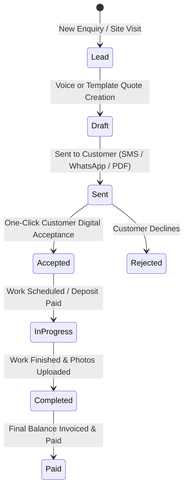

# BuilderBot — Agent Instructions & Collaboration Hub

> **Note for AI Agents**: This document tracks project context, architecture, completed milestones, conventions, active roadmap, and feature ideas. Whenever you make significant changes, update the **Changelog & Completed Work** section, check off completed roadmap items, and append new ideas to the **Ideas & Future Improvements** section before pushing.

---

## 📌 Project Overview
- **Name:** BuilderBot
- **Mission:** Create and send a professional, itemized quote in under two minutes for tradespeople (builders, plumbers, electricians, roofers, landscapers).
- **The Killer Differentiator:** **"Speak your quote and let AI build it."** A tradesperson taps a single button in their van, dictates the job in plain English, and AI expands, prices, and formats a client-ready quote with deposit collection.
- **Primary Repository:** `https://github.com/wazzheed79/builderbot.git`
- **Application Directory:** `builderbot-app/`

---

## 🛠 Tech Stack & Architecture
- **Framework:** Next.js 16 (App Router, React 19)
- **Language:** TypeScript (`strict: true`)
- **Styling:** Tailwind CSS (mobile-first, clean, high-contrast for on-site tradespeople)
- **Icons:** `lucide-react`
- **Speech / Audio:** Web Speech API / Audio Recording for Voice Quotes
- **Backend / Database:** Supabase (Auth, Postgres, Storage)
- **AI Engine:** Google Gemini (fast structured output with `gemini-2.5-flash`)
- **Payments:** Stripe (invoicing & deposit collection)
- **Deployment:** Vercel

---

## 📋 Quote Lifecycle Workflow

---

## 🚦 Agent Conventions & Guidelines
1. **Mobile-First Van Experience**: Tradespeople use this in their vans with work gloves or dirty hands. Large tap targets (min 44px), voice-ready, zero unnecessary forms.
2. **Auto-Push Policy**: Whenever a task or feature is completed and verified, stage all files, commit with a concise descriptive message, and push directly to GitHub.
3. **Deterministic Prerender Compatibility**: In Next.js 16 Partial Prerendering, avoid calling `Math.random()` or `new Date()` directly in static JSX trees. Use static values, `useEffect`, or cached props.
4. **Keep Docs in Sync**: Keep this file and `README.md` aligned with any new routes or schema additions.

---

## 📝 Changelog & Completed Work
- [x] **Project Scaffolding**: Initialized Next.js App Router app with TypeScript and Tailwind CSS.
- [x] **Navigation & Shell**: Created unified responsive navigation (`components/AppNav.tsx`) with desktop header and thumb-friendly mobile bottom navigation bar.
- [x] **Landing Page Redesign (`app/page.tsx`)**: High-converting trade landing page with hero, live quote card mockup, trade badges, 3-step workflow, and clear CTAs.
- [x] **AI Quote Generator UI (`app/quotes/page.tsx`)**: Interactive generator with trade prompt presets, editable labor/materials line items, VAT toggle, deposit calculation, and print/share actions.
- [x] **Dashboard Overview (`app/dashboard/page.tsx`)**: KPI metrics (Quotes Sent, Won Value, Win Rate) and real-time recent quotes table.
- [x] **Customer Directory (`app/customers/page.tsx`)**: Searchable client list with phone, email, site address, and quote history.
- [x] **Repository & CI/CD**: Linked with GitHub remote (`wazzheed79/builderbot`), build verified, and continuously pushed.

---

## 🗺 Official Product Roadmap

### Phase 1: Core Quoting & Foundations
- [x] Responsive trade app shell & mobile navigation
- [x] Landing page with trade-focused value proposition
- [x] Interactive quote generator UI with labor/materials breakdown
- [ ] **Voice-to-Quote Prototype** (Web Speech API mic capture in quote form)
- [ ] **AI Job Description Assistant** (Expand raw notes into professional client-ready scopes)
- [ ] **PDF Branding & Generation** (Company logo, trade accreditations, T&Cs, payment terms)
- [ ] **Customer Shareable Link & One-Click Acceptance Page** (`/q/[id]` with Accept/Decline)

### Phase 2: Trade Intelligence & Speed
- [ ] **1-Click Quote Templates** (Kitchen renovation, Bathroom installation, Roof repair, Boiler swap)
- [ ] **Labour & Margin Calculator** (Materials + Markup % + Day Rate x Days + VAT)
- [ ] **Customer History & Lightweight CRM** (Past quotes, accepted jobs, outstanding revenue)
- [ ] **Supabase Database & Auth Integration** (`profiles`, `customers`, `quotes`, `quote_items`)

### Phase 3: Conversions & Pipeline
- [ ] **Stripe Deposit Collection** (Collect 20% or custom deposit upon quote signing)
- [ ] **Job Pipeline Dashboard** (Lead → Quote Sent → Accepted → In Progress → Completed → Paid)
- [ ] **Photo Uploads** (Before, in-progress, and finished work photos attached to quotes)
- [ ] **Calendar & Scheduling Integration** (Project start dates, completion milestones)

### Phase 4: Full Automation & Scale
- [ ] Native Mobile App (PWA or React Native)
- [ ] Trade Supplier Material Cost Integrations (Screwfix, Toolstation pricing lookups)
- [ ] WhatsApp & SMS automated quote delivery and reminder follow-ups
- [ ] Revenue analytics & tax summaries

---

## 💡 The 10 Core Pillars & Ideas

1. **Quote Templates**: Instant presets for common jobs (Kitchens, Bathrooms, Driveways, Boilers, Roofing).
2. **Materials & Labour Margin Calculator**: Auto-calculates net material cost + trade markup + labor days x day rate + VAT.
3. **Customer History (CRM)**: Customer profiles showing total spend, previous quotes, and notes.
4. **AI Job Description Expander**: Transforms raw bullet points into polished, professional descriptions that win higher-value jobs.
5. **PDF Branding**: Clean PDF exports with business logo, contact info, insurance details, and standard T&Cs.
6. **Quote Acceptance Page**: Clean public URL where clients can click "Accept Quote" or "Decline" with digital signature.
7. **Job Pipeline Kanban/List**: Full visibility from Lead to Paid.
8. **Site Photo Attachments**: Before/after and site condition photos stored with quotes.
9. **Project Calendar**: Start and target completion dates with calendar sync.
10. **Voice Quoting (Killer Feature)**: Speak for 30 seconds into a phone on site; AI generates the entire structured quote.
