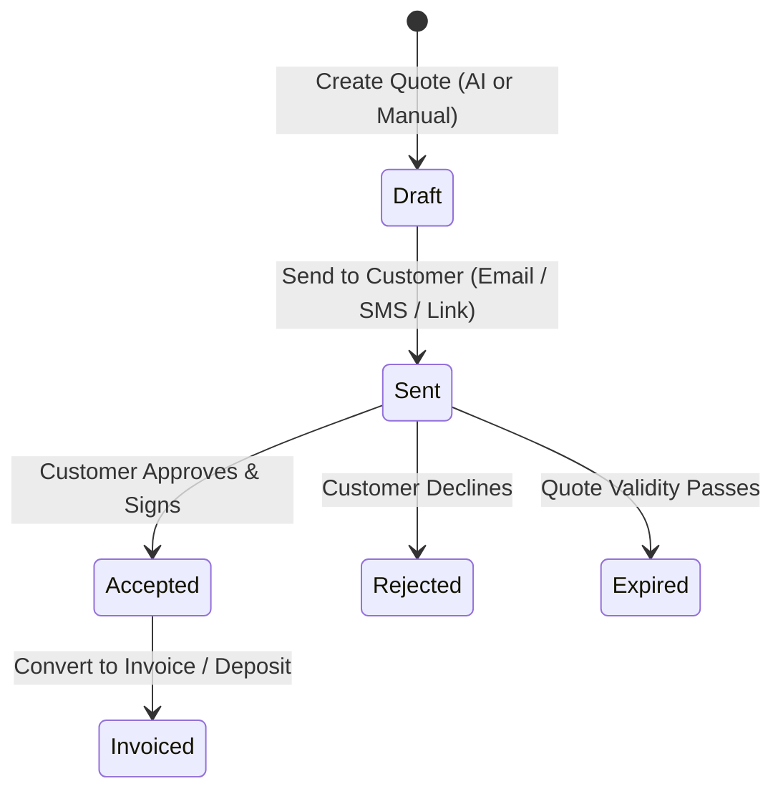

# BuilderBot — Agent Instructions & Collaboration Hub

> **Note for AI Agents**: This document tracks project context, architecture, completed milestones, conventions, and upcoming ideas. Whenever you make significant changes, update the **Changelog & Completed Work** section, check off completed roadmap items, and append new ideas or suggestions to the **Ideas & Future Improvements** section before pushing.

---

## 📌 Project Overview
- **Name:** BuilderBot
- **Mission:** Create and send a professional, itemized quote in under two minutes for tradespeople (builders, plumbers, electricians, roofers, landscapers).
- **Primary Repository:** `https://github.com/wazzheed79/builderbot.git`
- **Application Directory:** `builderbot-app/`

---

## 🛠 Tech Stack & Architecture
- **Framework:** Next.js 16 (App Router, React 19)
- **Language:** TypeScript (`strict: true`)
- **Styling:** Tailwind CSS (mobile-first, clean, high-contrast for on-site tradespeople)
- **Icons:** `lucide-react`
- **Backend / Database:** Supabase (Auth, Postgres, Storage)
- **AI Engine:** Google Gemini / OpenAI (for parsing job descriptions and generating itemized quotes)
- **Payments:** Stripe (invoicing & deposit collection)
- **Deployment:** Vercel

---

## 📋 Quote Lifecycle Workflow

---

## 🚦 Agent Conventions & Guidelines
1. **Mobile-First Trade Design**: Many users will create or review quotes on mobile devices on job sites. Keep buttons large, tap targets accessible, and layouts clean.
2. **Auto-Push Policy**: Whenever a task or feature is completed and verified, stage the files, commit with a concise descriptive message, and push directly to GitHub.
3. **Deterministic Prerender Compatibility**: In Next.js 16 Partial Prerendering, avoid calling `Math.random()` or `new Date()` directly in static JSX trees. Use static values, `useEffect`, or cached props.
4. **Keep Docs in Sync**: If you add new routes, dependencies, or env variables, update this file and `README.md`.

---

## 📝 Changelog & Completed Work
- [x] **Project Scaffolding**: Initialized Next.js App Router app with TypeScript and Tailwind CSS.
- [x] **Navigation & Shell**: Created unified responsive navigation (`components/AppNav.tsx`) with desktop header and thumb-friendly mobile bottom navigation bar.
- [x] **Landing Page Redesign (`app/page.tsx`)**: High-converting trade landing page with hero, live quote card mockup, trade badges, 3-step workflow, and clear CTAs.
- [x] **AI Quote Generator UI (`app/quotes/page.tsx`)**: Interactive generator with trade prompt presets (Plumbing, Electrical, Carpentry), editable labor/materials line items, VAT toggle, deposit calculation, and print/share actions.
- [x] **Dashboard Overview (`app/dashboard/page.tsx`)**: KPI metrics (Quotes Sent, Won Value, Win Rate) and real-time recent quotes table.
- [x] **Customer Directory (`app/customers/page.tsx`)**: Searchable client list with phone, email, site address, and quote history.
- [x] **Repository & CI/CD**: Linked with GitHub remote (`wazzheed79/builderbot`), build verified, and continuously pushed.

---

## 🗺 Active Roadmap & Next Tasks
- [ ] **Supabase Integration & Database Schema**:
  - Connect Supabase client (`@supabase/supabase-js`, `@supabase/ssr`).
  - Tables: `profiles`, `customers`, `quotes`, `quote_items`.
- [ ] **Real AI Endpoint (Gemini API)**:
  - Wire `/api/generate-quote` route using `@google/genai` or Gemini SDK with structured output (`gemini-2.5-flash`).
  - Parse trade voice notes and raw descriptions into JSON line items.
- [ ] **PDF Quote Export**:
  - Server-side or client-side PDF rendering (`@react-pdf/renderer`) with trade logo and signature line.
- [ ] **Customer Shareable Link**:
  - Public route `/q/[id]` where customers can review, accept, and sign quotes digitally.
- [ ] **Stripe Deposit Checkout**:
  - Add Stripe checkout session upon quote acceptance to lock in booking deposits.

---

## 💡 Ideas & Future Opportunities
*Agents working on this repository are encouraged to add ideas below:*
- **Voice Note Quoting**: Allow tradespeople to record a 30-second voice memo while driving away from a job site, which auto-generates the draft quote.
- **WhatsApp / SMS Quote Delivery**: Send a direct interactive link to the customer via WhatsApp/SMS where they can tap "Accept" on their phone.
- **Deposit Collection via Stripe**: Require a 20% or custom deposit upon quote acceptance before scheduling work.
- **Material Cost Lookup**: Integrate with common trade suppliers (Screwfix, Toolstation, Home Depot, etc.) for real-time material pricing.
- **Before & After Photo Uploads**: Allow attaching site photos directly to quotes to clarify scope of work.
