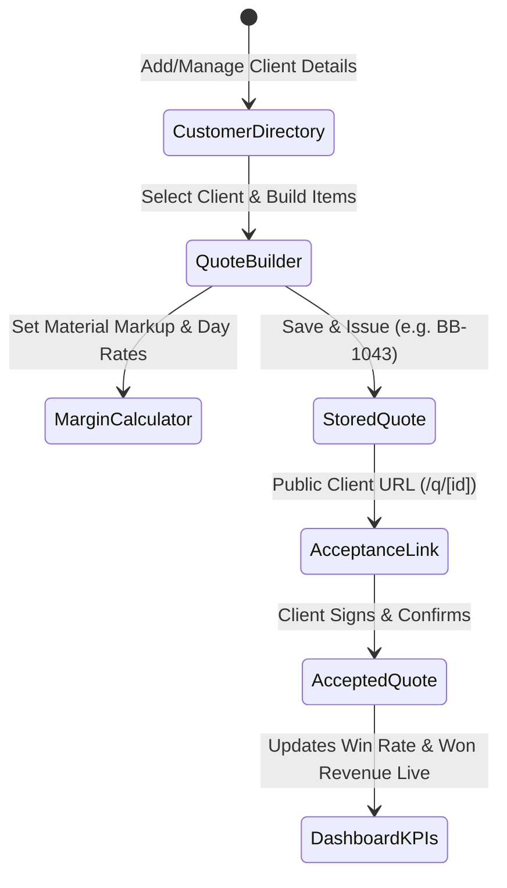

# Chuffed Quotes — Agent Instructions & Collaboration Hub

> **Note for AI Agents**: This document tracks project context, architecture, completed milestones, conventions, active roadmap, and feature ideas. Whenever you make significant changes, update the **Changelog & Completed Work** section, check off completed roadmap items, and append new ideas to the **Ideas & Future Improvements** section before pushing.

---

## 📌 Project Overview
- **Name:** Chuffed Quotes (short form Chuffed). Change it only in `builderbot-app/lib/brand.mjs`. The GitHub repo folder is still called builderbot.
- **Mission:** Create and send a professional, itemized quote in under two minutes for tradespeople (builders, plumbers, electricians, roofers, landscapers).
- **The Killer Differentiator:** **"Speak your quote and let AI build it."** A tradesperson taps a single button in their van, dictates the job in plain English, and AI expands, prices, and formats a client-ready quote with deposit collection.
- **Primary Repository:** `https://github.com/wazzheed79/builderbot.git`
- **Application Directory:** `builderbot-app/`

---

## 🛠 Tech Stack & Architecture
- **Framework:** Next.js 16 (App Router, React 19)
- **Language:** TypeScript (`strict: true`)
- **Styling:** Tailwind CSS (mobile-first, clean, high-contrast for on-site tradespeople)
- **Icons:** `lucide-react`
- **Speech / Audio:** Web Speech API / Voice Dictation for Van Use
- **State & Data Store:** `lib/storage.ts` (Client repository for Customers, Quotes, and Dashboard KPIs)
- **Backend / Database:** Supabase (Auth, Postgres, Storage)
- **AI Engine:** Google Gemini (structured JSON quotes). The model id lives in `builderbot-app/lib/gemini.mjs`, defaults to `gemini-3.5-flash`, and can be overridden with `GEMINI_MODEL`.
- **Payments:** Stripe (invoicing & deposit collection)
- **Deployment:** Vercel

---

## 📋 Complete Data Flow Loop

---

## 🚦 Agent Conventions & Guidelines
1. **Mobile-First Van Experience**: Tradespeople use this in their vans with work gloves or dirty hands. Large tap targets (min 44px), voice-ready, zero unnecessary forms.
2. **Review-First Verification Policy**: Do not auto-push to GitHub without explicit user review. All changes must be tested, linted, verified, and presented to the user for confirmation before committing and pushing.
3. **Deterministic Prerender Compatibility**: In Next.js 16 Partial Prerendering, wrap dynamic hook consumers (`usePathname()`, `useSearchParams()`, `params`) in `<Suspense>` and avoid calling non-deterministic APIs (`Math.random()`, `new Date()`) directly in JSX during static builds.
4. **Data Sync**: When adding new fields to `Customer` or `Quote`, update `lib/storage.ts` and sync across the Customer Directory, Quote Builder, Customer Acceptance view, and Dashboard.

---

## 📝 Changelog & Completed Work
- [x] **Configurable Gemini model**: Quote generation and scope expansion share one model setting (`GEMINI_MODEL`, default `gemini-3.5-flash`). New Google keys no longer accept `gemini-2.5-flash`. If Gemini returns 404, 429, 503, times out, or sends unusable JSON, the quote falls back to the existing rough estimate instead of an error.
- [x] **Homepage sample quote spacing**: Qty, rate, and line total on the landing-page quote preview each have a label and their own column, so the prices no longer run together on a phone.
- [x] **Free public beta**: One product name in `lib/brand.mjs` (Chuffed Quotes), empty start instead of fake customers, AI only for signed-in users, card payments switched off, quote accept rules, pinch-zoom, and layout that stays on the page at phone, tablet, and desktop widths.
- [x] **Voice-first homepage**: Talk or type on the home page, a short notes-to-quote animation, a founding-member offer (first 100 sign-ups, free for 12 months), and a Share on WhatsApp button for the customer link. Customer-facing copy uses plain British spelling.
- [x] **Owner details on privacy and terms**: Public pages name Michael Boylen and the contact email. The old bracket placeholders are gone.
- [x] **Project Scaffolding**: Initialized Next.js App Router app with TypeScript and Tailwind CSS.
- [x] **Navigation & Shell**: Created unified responsive navigation (`components/AppNav.tsx`) with desktop header and thumb-friendly mobile bottom navigation bar.
- [x] **Landing Page & Comparison**: High-converting trade landing page with a side-by-side contrast section (`app/page.tsx`).
- [x] **Unified Persistence Layer (`lib/storage.ts`)**: Central client data repository managing real Customers, Quotes, Line Items, and computed Dashboard KPI metrics.
- [x] **Real Customer Management CRM (`app/customers/page.tsx`)**: Add, edit, and delete real customers with company, phone, email, address, notes, and 1-click quote creation.
- [x] **Connected Quote Builder (`app/quotes/QuotesClient.tsx`)**: Select real customers from directory, add custom line items, calculate margins, and save permanent quotes (`BB-1043`).
- [x] **Voice-to-Quote Dictation**: Integrated speech recognition with visual listening indicator for hands-free quoting in vans.
- [x] **AI Job Description Assistant**: "✨ Expand to Professional Scope" button turns raw notes into contract-grade trade specifications.
- [x] **1-Click High-Priority Quote Templates**: 5 fully itemized trade templates (Kitchen Renovation, Bathroom Installation, Roof Repair, Block Paved Driveway, Combi Boiler Replacement).
- [x] **Materials & Labour Margin Calculator**: Built-in pricing estimator for Net Materials + Markup % + Days x Day Rate + Waste/Skip.
- [x] **Customer Acceptance Page (`/q/[id]`)**: Full public client-facing page with contractor accreditation badges, digital signature capture, acceptance confirmation, and decline feedback linked to storage.
- [x] **Live Dashboard Metrics (`app/dashboard/page.tsx`)**: Real-time KPI metrics (Quotes Sent, Won Contract Value, Win Rate %, Pending Value) dynamically calculated from stored quotes.
- [x] **Repository & CI/CD**: Verified with clean Next.js 16 build and pushed to GitHub (`wazzheed79/builderbot`).
- [x] **Business Profile & Branding System (`app/settings/page.tsx`, `lib/storage.ts`)**: User-editable profile for company details, trading name, bank details for wire deposits, and legitimate trade accreditations (removed the hardcoded sample company and one-tap fake registration badges).
- [x] **Real Server-Side Gemini AI Endpoints (`app/api/quote/generate`, `app/api/quote/expand`)**: Official `@google/genai` SDK integration with strict JSON schemas, providing intelligent itemization, market rates, and contract-ready scopes. The model id is shared (`lib/gemini.mjs`, default `gemini-3.5-flash`) and a failed call falls back to the rough estimate.
- [x] **Supabase Multi-Device Cloud Sync (`lib/supabase.ts`, `app/api/quote/[id]`, `supabase/schema.sql`)**: Postgres tables with RLS and public token resolution allowing clients on any smartphone or browser to view, accept, and sign quotes remotely.
- [x] **Clean Zero-Warning Production Build**: Resolved all 14 ESLint errors and Next.js 16 partial prerendering issues.

---

## 🗺 Official Product Roadmap

### Phase 1: Core Quoting & Foundations
- [x] Responsive trade app shell & mobile navigation
- [x] Landing page with the old way compared with Chuffed Quotes
- [x] Unified persistence layer for Customers, Quotes, and Metrics
- [x] Real Customer Management (CRM)
- [x] Real Quote Builder with Customer linking & saving
- [x] Voice-to-Quote mic dictation in quote form
- [x] AI Job Description Scope Expander
- [x] 1-Click Quote Templates (Kitchen, Bathroom, Roof, Driveway, Boiler)
- [x] Labour & Materials Margin Calculator
- [x] Customer Shareable Link & Digital Acceptance Page (`/q/[id]`)
- [x] Live Dashboard KPI Metrics (Win rate, Won value, Pipeline)
- [x] **Business Profile & Branding System** (Custom trade accreditations, bank deposit instructions, terms & conditions)

### Phase 2: Trade Intelligence & Speed
- [x] **Supabase Database Cloud Architecture** (Multi-device public tokens, schemas, and live API route)
- [x] **Real Gemini API Endpoints** (Official `@google/genai` SDK parsing voice and notes into structured JSON)
- [ ] **Customer Profile Detail Page** (Deep dive into customer's lifetime quotes, notes, and photos)

### Phase 3: Conversions & Pipeline
- [ ] **Stripe Deposit Collection** (Collect 20% or custom deposit directly upon customer signing)
- [ ] **Job Pipeline Kanban Dashboard** (Lead → Quote Sent → Accepted → In Progress → Completed → Paid)
- [ ] **Site Photo Attachments** (Before/after and site condition photos stored with quotes)
- [ ] **Calendar & Scheduling Integration** (Project start dates, completion milestones)

### Phase 4: Full Automation & Scale
- [ ] Native Mobile App (PWA or React Native)
- [ ] Trade Supplier Material Cost Integrations (Screwfix, Toolstation pricing lookups)
- [ ] WhatsApp & SMS automated quote delivery and reminder follow-ups
- [ ] Revenue analytics & tax summaries
