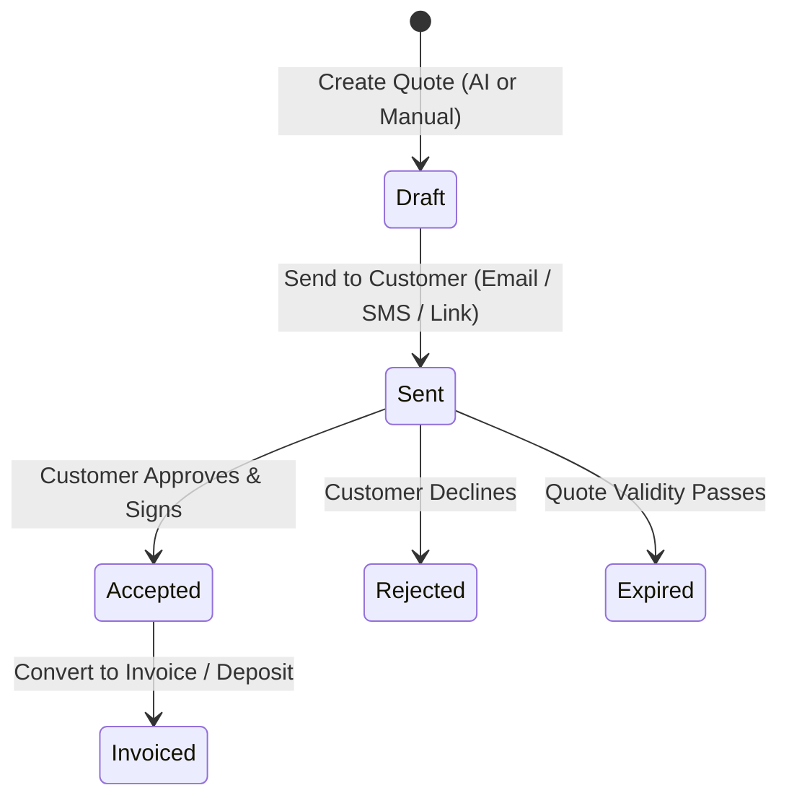

# BuilderBot — Agent Instructions & Collaboration Hub

> **Note for AI Agents**: This document tracks project context, architecture, completed milestones, conventions, and upcoming ideas. Whenever you make significant changes, update the **Changelog & Completed Work** section, check off completed roadmap items, and append new ideas or suggestions to the **Ideas & Future Improvements** section before pushing.

---

## 📌 Project Overview
- **Name:** BuilderBot
- **Mission:** Create and send a professional, itemized quote in under two minutes for tradespeople (builders, plumbers, electricians, roofers, landscapers).
- **Primary Repository:** `https://github.com/wazzheed79/builderbot.git`
- **Application Directory:** `builderbot-app/`

---

## 🛠 Tech Stack & Architecture
- **Framework:** Next.js (App Router, React 19)
- **Language:** TypeScript (`strict: true`)
- **Styling:** Tailwind CSS (mobile-first, clean, high-contrast for on-site tradespeople)
- **Backend / Database:** Supabase (Auth, Postgres, Storage)
- **AI Engine:** Google Gemini / OpenAI (for parsing job descriptions and generating itemized quotes)
- **Payments:** Stripe (invoicing & deposit collection)
- **Deployment:** Vercel

---

## 📋 Quote Lifecycle Workflow

---

## 🚦 Agent Conventions & Guidelines
1. **Mobile-First Trade Design**: Many users will create or review quotes on mobile devices on job sites. Keep buttons large, tap targets accessible, and layouts clean.
2. **Auto-Push Policy**: Whenever a task or feature is completed and verified, stage the files, commit with a concise descriptive message, and push directly to GitHub.
3. **Keep Docs in Sync**: If you add new routes, dependencies, or env variables, update this file and `README.md`.
4. **Fast & Resilient**: Use Server Actions / API routes with proper error handling and fallback states.

---

## 📝 Changelog & Completed Work
- [x] **Project Scaffolding**: Initialized Next.js App Router app with TypeScript and Tailwind CSS.
- [x] **Core Route Placeholders**:
  - `app/page.tsx` — Landing page
  - `app/dashboard/page.tsx` — Tradesperson overview & metrics
  - `app/quotes/page.tsx` — Quote list & generation
  - `app/customers/page.tsx` — Client contact directory
- [x] **Repository & CI/CD**: Linked with GitHub remote (`wazzheed79/builderbot`) and configured for agent collaboration.

---

## 🗺 Active Roadmap & Tasks
- [ ] **Navigation & Shell**: Create a unified responsive navigation layout (Sidebar on desktop, bottom navigation bar on mobile).
- [ ] **Landing Page Redesign**: Polish `app/page.tsx` with hero section, feature breakdown, social proof, and call-to-actions.
- [ ] **Database & Auth (Supabase)**:
  - Setup tables: `profiles`, `customers`, `quotes`, `quote_items`.
  - Authentication flow (tradesperson login/signup).
- [ ] **AI Quote Generator**:
  - Voice-to-text or freeform job description input ("Replaced 4 downlights and 1 consumer unit in kitchen").
  - AI prompt to parse into labor, materials, rates, and totals.
- [ ] **PDF Quote Export**: Clean, branded PDF generation with business logo, customer details, and signature line.
- [ ] **Customer Directory**: Add, edit, view customer contact details and quote history.

---

## 💡 Ideas & Future Opportunities (Add Yours Here!)
*Agents working on this repository are encouraged to add ideas below:*
- **Voice Note Quoting**: Allow tradespeople to record a 30-second voice memo while driving away from a job site, which auto-generates the draft quote.
- **WhatsApp / SMS Quote Delivery**: Send a direct interactive link to the customer via WhatsApp/SMS where they can tap "Accept" on their phone.
- **Deposit Collection via Stripe**: Require a 20% or custom deposit upon quote acceptance before scheduling work.
- **Material Cost Lookup**: Integrate with common trade suppliers (Screwfix, Toolstation, Home Depot, etc.) for real-time material pricing.
