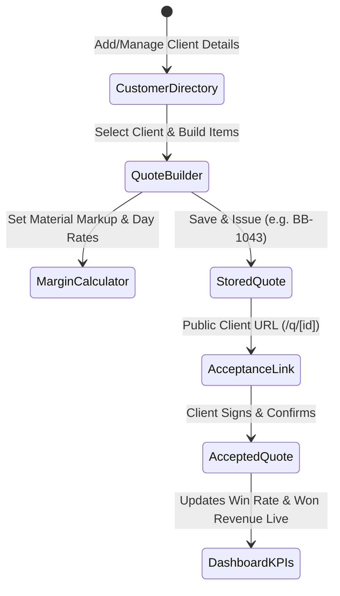

# Chuffed Quotes — Agent Instructions & Collaboration Hub

> **Note for AI Agents**: This document tracks project context, architecture, completed milestones, conventions, active roadmap, and feature ideas. When a change alters behaviour, setup, or the roadmap, update `CHANGELOG.md` and the **Progress / Changelog** section of `README.md` in the same commit and pull request. Also check off completed roadmap items here, and append new ideas to **Ideas & Future Improvements**. The rule is repeated in `GEMINI.md` and `.agents/rules/keep-docs-updated.md` so Google Antigravity sees it. Do not add a hook or Action that commits those files to `main` by itself, and do not add new secrets to do it.

---

## 📌 Project Overview
- **Name:** Chuffed Quotes (short form Chuffed). Change it only in `builderbot-app/lib/brand.mjs`. The GitHub repo folder is still called builderbot.
- **Mission:** Create and send a professional, itemized quote in under two minutes for tradespeople (builders, plumbers, electricians, roofers, landscapers).
- **The main idea:** A tradesperson talks or types the job in plain English. AI drafts an itemised quote. They check the prices, send a link, and the customer signs on their phone. Card deposits are switched off during the beta.
- **Primary Repository:** `https://github.com/wazzheed79/builderbot.git`
- **Application Directory:** `builderbot-app/`

---

## 🛠 Tech Stack & Architecture
- **Framework:** Next.js 16 (App Router, React 19)
- **Language:** TypeScript (`strict: true`)
- **Styling:** Tailwind CSS (mobile-first, clean, high-contrast for on-site tradespeople)
- **Icons:** `lucide-react`
- **Speech / Audio:** Web Speech API / Voice Dictation for Van Use
- **State & Data Store:** `lib/storage.ts` (Client repository for Customers, Quotes, and Dashboard KPIs)
- **Backend / Database:** Supabase (Auth, Postgres, Storage)
- **AI Engine:** Google Gemini (structured JSON quotes). The model id lives in `builderbot-app/lib/gemini.mjs`, defaults to `gemini-3.5-flash`, and can be overridden with `GEMINI_MODEL`.
- **Payments:** Stripe code is present. Card payments and deposits are switched off in the free beta. Leave the Stripe keys blank. Invoices exist without taking a card.
- **Deployment:** Vercel. Live site: https://www.chuffedquotes.co.uk

---

## 📋 Complete Data Flow Loop

---

## 🚦 Agent Conventions & Guidelines
1. **Mobile-First Van Experience**: Tradespeople use this in their vans with work gloves or dirty hands. Large tap targets (min 44px), voice-ready, zero unnecessary forms.
2. **Review-First Verification Policy**: Do not auto-push to GitHub without explicit user review. All changes must be tested, linted, verified, and presented to the user for confirmation before committing and pushing. The owner merges to `main`. Do not add automation that commits docs or code to `main` by itself.
3. **Deterministic Prerender Compatibility**: In Next.js 16 Partial Prerendering, wrap dynamic hook consumers (`usePathname()`, `useSearchParams()`, `params`) in `<Suspense>` and avoid calling non-deterministic APIs (`Math.random()`, `new Date()`) directly in JSX during static builds.
4. **Data Sync**: When adding new fields to `Customer` or `Quote`, update `lib/storage.ts` and sync across the Customer Directory, Quote Builder, Customer Acceptance view, and Dashboard.

---

## 📝 Changelog & Completed Work

The dated record of what shipped is `CHANGELOG.md`, with a shorter copy in `README.md`. This list is the working memory for agents. Add a line here when you ship something, and add the same fact to those two files.

- [x] **Price list on the quote, and number boxes that can be cleared**: Build the quote uses a matching saved price and the Settings day or hourly rate. Matching lines say “From your price list”. The quote editor has Add from my price list. Quantity, rate, and Settings number boxes can be emptied while typing, so a lone 0 is replaced instead of becoming 050. No database migration.
- [x] **PostHog events and the phone try-it page**: PostHog’s own `token` and `$` fields survive the privacy check, so events are no longer dropped. Names, emails, phones, job notes, and other secrets are still removed. `/try` also counts `demo_build_clicked` (example button or not), `demo_quote_generated`, and `demo_build_failed` (`empty_input`, `daily_limit`, or `ai_error`), only after Accept, with no job text. Signed-out visitors do not see the bottom tab bar on public pages. The try-it phone screen leads with the example buttons and the job notes. The cookie banner is a shorter row.
- [x] **My price list**: A signed-in tradesperson can add, edit, and delete their own prices at `/settings/prices` (name, unit, pounds). Those prices, and prices already typed on a quote, live in `price_memory` and are sent with an AI quote so the draft uses them and fills in the quantities. Guests on `/try` do not save or send a price list. No database migration. The home page and `/try` say the day rate and price list are used once they are saved, and that the try-out itself uses example prices.
- [x] **Quick van demo**: The home page and `/walkthrough` play five finished clips in one voice (`step-1.mp3` to `step-5.mp3`, about 32 seconds together). Each step waits until its clip ends. Sound starts on a tap, stops after the last step, and stops when the popup closes. The on-screen words match the app: the customer types their name, prices are an example, and the sample bank details are obviously fake. The headline says a couple of minutes. The fuse-board example and consumer-unit template say EIC, not EICR.
- [x] **Try a quote with no account**: `/try` lets a visitor type notes or tap a decorating, plumbing, or electrics example and see Standard, Better, and Premium plus a customer-page preview under “Your Business Name”. Nothing is saved, emailed, or given a public link. Five builds a day per network address, using the existing Supabase rate limit, with the same AI output checks. After sign-up the quote is waiting in the builder. The signed-in route is unchanged. No database migration. PostHog counts `demo_started`, `demo_build_clicked`, `demo_quote_generated`, `demo_build_failed`, and `demo_signup_clicked` only after Accept. Job notes are not sent.
- [x] **README, changelog, and agent docs rule**: Root `README.md` and `CHANGELOG.md` describe the product as it is. Later changes update both in the same pull request. Antigravity reads `GEMINI.md` and `.agents/rules/keep-docs-updated.md`.
- [x] **AI rate limits and quote numbers**: AI quoting calls the rate-limit and hourly quota checks with the service-role client. If that check itself fails, the quote is allowed and the fault is logged, while a real “limit reached” answer still stops it. New quotes get their own reference instead of the shared BB-1041 sequence. An old number that already belongs to another account is given a new reference on save. Existing quotes, customer links, and invoices stay on their current ids. No database migration.
- [x] **Sentry errors and PostHog counts**: Error reports go to Sentry only when `NEXT_PUBLIC_SENTRY_DSN` is set, with a low trace sample and personal details stripped out. PostHog starts only after Accept, stays off without its key and host, and does not record customer quote or invoice pages. The privacy notice names both.
- [x] **Invoices, saved templates, and the old domain**: A sent or accepted quote can become an invoice (INV-0001 onwards) with the chosen price, VAT, and payment details from Settings. Invoices can be edited, shared, printed, and marked paid. A quote’s lines can be saved as a private template. Requests to tradematequotes.co.uk permanently redirect to the same path on www.chuffedquotes.co.uk. Apply `builderbot-app/supabase/migrations/20261021140000_invoices_templates_public_link.sql` before that code is merged.
- [x] **Clearer landing, phone quote editor, and customer quote**: Signed-out visitors get a one-line explanation, three steps, a short feature list, a free-beta sign-up, and a FAQ. The quote editor’s phone layout keeps large tap targets, a sticky save action, and totals that stay on the screen. The customer quote and its printout use a clearer letterhead, labelled line prices, and the same accept flow.
- [x] **AI quote checks, durable limits, and one view per day**: Gemini line items and scope text are checked before they are used. A broken reply falls back to the rough estimate, and prices stay inside the existing limits. API rate limits are stored in Supabase so a new server does not reset them. The same phone opening a quote again within a day does not add another view. Apply `builderbot-app/supabase/migrations/20261021110000_rate_limits_and_view_dedupe.sql` before that code is merged.
- [x] **Draft recovery, AI quota, and printable quotes**: A quote being written is kept in this browser and offered back after a refresh or a closed tab. Signed-in drafts also upload when the signal returns. AI builds stop after 30 an hour, and a failed quota check refuses another build instead of ignoring the limit. Printed quotes wrap long lines, split a long list across pages, and format pounds with pence. Accepted quotes no longer invent a bank name or sort code.
- [x] **Business name, privacy, sample quote, and tap-to-sign-in**: Quotes are not sent until a real business name is saved. Privacy and terms describe the live beta. The homepage example matches the en-suite quote, and the free-beta offer matches the terms. Email links open /auth/confirm and are only used when the person taps.
- [x] **Customer sign box**: Accept and decline errors show inside the box. A quote with Standard, Better, and Premium can be chosen there, and the signed confirmation appears after the quote is saved.
- [x] **Phone test fixes**: A real customer link opens again. The public lookup uses `get_public_quote`, which the anon key may call, because row security hides the quotes table from that key. Save and WhatsApp send the lines on the screen, and Good/Better/Best are built from those lines. The quote editor fits a 360px-wide phone. Sign-in leads with the email link.
- [x] **Quote link preview picture**: A customer’s WhatsApp card uses that quote’s own picture, not the general site card. A link that is not a real quote returns a not-found page.
- [x] **Quote cards, views, prices, and options**: Each customer link can show its own WhatsApp preview. Opening the quote is counted in Supabase, with a reminder on WhatsApp after three days. Edited prices are remembered for the next similar line. A quote can offer Standard, Better, and Premium, and the customer picks one.
- [x] **Email link sign-in**: The default Supabase magic-link email only contains the link, so tapping that link signs the person in and opens the dashboard. A 6-digit code can still be typed in when the email shows one. Password sign-in stays.
- [x] **Live-site audit fixes**: Customer links are only offered after the quote is saved online (guests are asked to sign in). The “this browser only” banner waits until the page has loaded, so it no longer breaks the page. Link previews, page titles, a 16px mobile text size, local QR codes, a once-only cloud sync, and a tighter rough estimate are in. AI quoting stays signed-in only. Database grants, row rules, and indexes are in `supabase/schema.sql` and a re-runnable migration.
- [x] **Configurable Gemini model**: Quote generation and scope expansion share one model setting (`GEMINI_MODEL`, default `gemini-3.5-flash`). New Google keys no longer accept `gemini-2.5-flash`. If Gemini returns 404, 429, 503, times out, or sends unusable JSON, the quote falls back to the existing rough estimate instead of an error.
- [x] **Homepage sample quote spacing**: Qty, rate, and line total on the landing-page quote preview each have a label and their own column, so the prices no longer run together on a phone.
- [x] **Free public beta**: One product name in `lib/brand.mjs` (Chuffed Quotes), empty start instead of fake customers, AI only for signed-in users, card payments switched off, quote accept rules, pinch-zoom, and layout that stays on the page at phone, tablet, and desktop widths.
- [x] **Voice-first homepage**: Talk or type on the home page, a short notes-to-quote animation, a founding-member offer (first 100 sign-ups, free for 12 months), and a Share on WhatsApp button for the customer link. Customer-facing copy uses plain British spelling.
- [x] **Owner details on privacy and terms**: Public pages name Michael Boylen and the contact email. The old bracket placeholders are gone.
- [x] **Project Scaffolding**: Initialized Next.js App Router app with TypeScript and Tailwind CSS.
- [x] **Navigation & Shell**: Created unified responsive navigation (`components/AppNav.tsx`) with desktop header and thumb-friendly mobile bottom navigation bar.
- [x] **Landing Page & Comparison**: High-converting trade landing page with a side-by-side contrast section (`app/page.tsx`).
- [x] **Unified Persistence Layer (`lib/storage.ts`)**: Central client data repository managing real Customers, Quotes, Line Items, and computed Dashboard KPI metrics.
- [x] **Real Customer Management CRM (`app/customers/page.tsx`)**: Add, edit, and delete real customers with company, phone, email, address, notes, and 1-click quote creation.
- [x] **Connected Quote Builder (`app/quotes/QuotesClient.tsx`)**: Select real customers from directory, add custom line items, calculate margins, and save permanent quotes (`BB-1043`).
- [x] **Voice-to-Quote Dictation**: Integrated speech recognition with visual listening indicator for hands-free quoting in vans.
- [x] **AI Job Description Assistant**: "✨ Expand to Professional Scope" button turns raw notes into contract-grade trade specifications.
- [x] **1-Click High-Priority Quote Templates**: 5 fully itemized trade templates (Kitchen Renovation, Bathroom Installation, Roof Repair, Block Paved Driveway, Combi Boiler Replacement).
- [x] **Materials & Labour Margin Calculator**: Built-in pricing estimator for Net Materials + Markup % + Days x Day Rate + Waste/Skip.
- [x] **Customer Acceptance Page (`/q/[id]`)**: Full public client-facing page with contractor accreditation badges, digital signature capture, acceptance confirmation, and decline feedback linked to storage.
- [x] **Live Dashboard Metrics (`app/dashboard/page.tsx`)**: Real-time KPI metrics (Quotes Sent, Won Contract Value, Win Rate %, Pending Value) dynamically calculated from stored quotes.
- [x] **Repository & CI/CD**: Verified with clean Next.js 16 build and pushed to GitHub (`wazzheed79/builderbot`).
- [x] **Business Profile & Branding System (`app/settings/page.tsx`, `lib/storage.ts`)**: User-editable profile for company details, trading name, bank details for wire deposits, and legitimate trade accreditations (removed the hardcoded sample company and one-tap fake registration badges).
- [x] **Real Server-Side Gemini AI Endpoints (`app/api/quote/generate`, `app/api/quote/expand`)**: Official `@google/genai` SDK integration with strict JSON schemas, providing intelligent itemization, market rates, and contract-ready scopes. The model id is shared (`lib/gemini.mjs`, default `gemini-3.5-flash`) and a failed call falls back to the rough estimate.
- [x] **Supabase Multi-Device Cloud Sync (`lib/supabase.ts`, `app/api/quote/[id]`, `supabase/schema.sql`)**: Postgres tables with RLS and public token resolution allowing clients on any smartphone or browser to view, accept, and sign quotes remotely.
- [x] **Clean Zero-Warning Production Build**: Resolved all 14 ESLint errors and Next.js 16 partial prerendering issues.

---

## 🗺 Official Product Roadmap

### Phase 1: Core Quoting & Foundations
- [x] Responsive trade app shell & mobile navigation
- [x] Landing page with the old way compared with Chuffed Quotes
- [x] Unified persistence layer for Customers, Quotes, and Metrics
- [x] Real Customer Management (CRM)
- [x] Real Quote Builder with Customer linking & saving
- [x] Voice-to-Quote mic dictation in quote form
- [x] AI Job Description Scope Expander
- [x] 1-Click Quote Templates (Kitchen, Bathroom, Roof, Driveway, Boiler)
- [x] Labour & Materials Margin Calculator
- [x] Customer Shareable Link & Digital Acceptance Page (`/q/[id]`)
- [x] Live Dashboard KPI Metrics (Win rate, Won value, Pipeline)
- [x] **Business Profile & Branding System** (Custom trade accreditations, bank deposit instructions, terms & conditions)

### Phase 2: Trade Intelligence & Speed
- [x] **Supabase Database Cloud Architecture** (Multi-device public tokens, schemas, and live API route)
- [x] **Real Gemini API Endpoints** (Official `@google/genai` SDK parsing voice and notes into structured JSON)
- [x] **Customer Profile Detail Page** (`app/customers/[id]` — quotes, jobs, and invoices for that customer)

### Phase 3: Conversions & Pipeline
- [ ] **Stripe Deposit Collection** (Collect 20% or custom deposit directly upon customer signing)
- [ ] **Job Pipeline Kanban Dashboard** (Lead → Quote Sent → Accepted → In Progress → Completed → Paid)
- [x] **Site Photo Attachments** (photos on a quote, compressed in the browser, and optional photos sent with an AI draft)
- [ ] **Calendar & Scheduling Integration** (Project start dates, completion milestones)

### Phase 4: Full Automation & Scale
- [ ] Native Mobile App (home-screen PWA install already works; a store app is still to do)
- [ ] Trade Supplier Material Cost Integrations (Screwfix, Toolstation pricing lookups)
- [ ] WhatsApp & SMS automated quote delivery and reminder follow-ups
- [ ] Revenue analytics & tax summaries

## Ideas & Future Improvements
- [ ] Show a short per-account quote number on the paperwork (BB-1042 for that tradesperson) while the stored id stays unique across accounts.
- [ ] Turn on Supabase leaked-password protection. It is off, and the login page still offers a password. Dashboard setting only.
- [ ] Set `SENTRY_ORG`, `SENTRY_PROJECT`, and `SENTRY_AUTH_TOKEN` on Vercel so source maps upload. The token stays out of git.
- [ ] Fix React hydration warning #418 on `/quotes`. The quote summary renders `new Date()` during render.
- [ ] Rename the quote-builder toggle from “Good, Better, Best” to “Standard, Better, Premium” so it matches the option labels.
